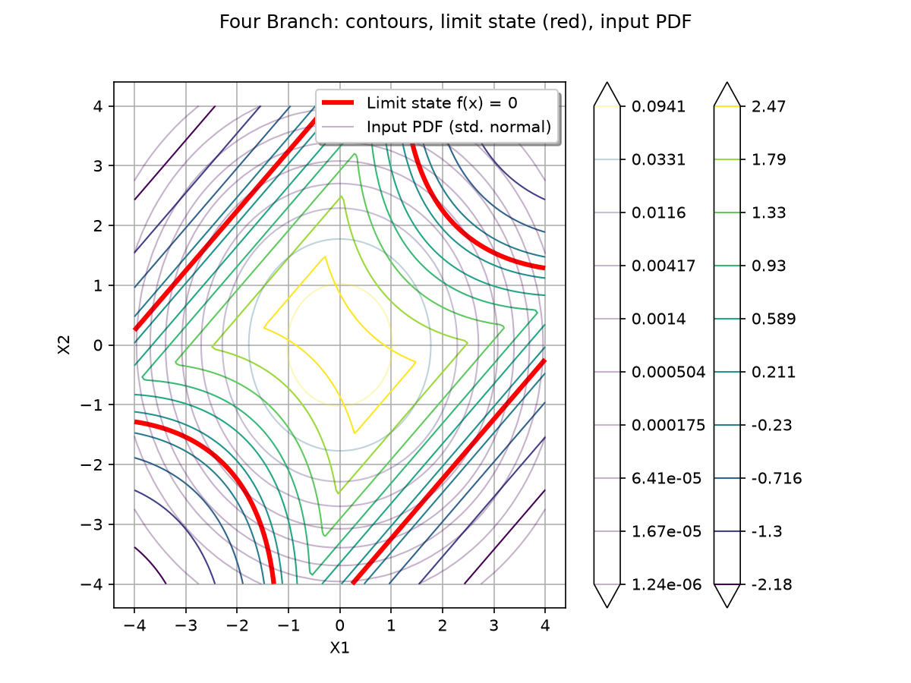

.. _use-case-four-branch:

The Four Branch function
========================

    Four Branch function: contours, limit state (red), input PDF (transparent)

The Four Branch function is a 2D limit state function introduced by
Schueremans and van Gemert (2005) [Schueremans2005]_ as a benchmark for
structural reliability analysis. It represents a series system with four
distinct failure modes (branches). The function has been widely used in
reliability literature, particularly for testing active learning methods
such as AK-MCS [Echard2011]_.

Definition
----------

Let the function :math:`f : \mathbb{R}^2 \times \mathbb{R} \rightarrow \mathbb{R}`
defined by:

.. math::
   :nowrap:

   \begin{align*}
   f(\vect{x}, p) = \min \begin{Bmatrix}
   3 + 0.1(x_1 - x_2)^2 - \frac{x_1 + x_2}{\sqrt{2}} \\
   3 + 0.1(x_1 - x_2)^2 + \frac{x_1 + x_2}{\sqrt{2}} \\
   (x_1 - x_2) + \frac{p}{\sqrt{2}} \\
   (x_2 - x_1) + \frac{p}{\sqrt{2}}
   \end{Bmatrix}
   \end{align*}

The function consists of four branches:
- Two quadratic branches (g1, g2) forming a parabolic shape opening upward
- Two linear branches (g3, g4) forming a diamond shape

The parameter :math:`p` controls the position of the linear branches.
The standard benchmark value is :math:`p = 6`.

Probabilistic Inputs (Standard Benchmark)
-----------------------------------------

The two input variables are modeled as independent standard normal random variables:

.. math::
   X_1, X_2 \sim \mathcal{N}(0, 1) \quad \text{independent}

+----------------+-----------------------------------------------+
| Input variable | Distribution                                  |
+================+===============================================+
| :math:`X_1`    | Normal(:math:`\mu=0`, :math:`\sigma=1`)       |
+----------------+-----------------------------------------------+
| :math:`X_2`    | Normal(:math:`\mu=0`, :math:`\sigma=1`)       |
+----------------+-----------------------------------------------+

**Table 1.** Distribution of the input random variables (standard benchmark).

The failure event is defined as:

.. math::
   F = \{ \vect{x} \in \mathbb{R}^2 : f(\vect{x}, p) \leq 0 \}

Reference Failure Probability
-----------------------------

The failure probability :math:`P_f = \mathbb{P}[f(\vect{X}, 6) \leq 0]` has been
estimated by several methods in the literature:

+--------+------------+----------------------+----------------+-----------------+
| Method | N          | :math:`\hat{P}_f`    | COV            | Source          |
+========+============+======================+================+=================+
| MCS    | :math:`10^6` | :math:`4.416\times10^{-3}` | 0.15%       | Echard et al. (2011) |
+--------+------------+----------------------+----------------+-----------------+
| IS     | 1469       | :math:`4.9\times10^{-3}`   | -            | Echard et al. (2011) |
+--------+------------+----------------------+----------------+-----------------+

**Table 2.** Reference values for the failure probability with :math:`p=6`.

Note on OpenTURNS Active Learning Examples
-------------------------------------------

The OpenTURNS active learning examples (e.g., `plot_active_learning_reliability.py`)
use a slightly different parameterization:

- Inputs: :math:`X_1, X_2 \sim \mathcal{N}(0, 1.5^2)` (independent)
- Parameter: :math:`p = 6` (same)
- Resulting failure probability: :math:`\approx 2.3 \times 10^{-3}`

This version can be obtained via :meth:`FourBranchModel.OpenTURNSActiveLearningVersion`.

Analysis
--------

The Four Branch function creates a non-convex failure domain with four distinct
branches meeting at the origin. The failure domain is the union of four regions:

1. **Region 1** (quadratic): :math:`3 + 0.1(x_1 - x_2)^2 - (x_1 + x_2)/\sqrt{2} \leq 0`
2. **Region 2** (quadratic): :math:`3 + 0.1(x_1 - x_2)^2 + (x_1 + x_2)/\sqrt{2} \leq 0`
3. **Region 3** (linear): :math:`x_1 - x_2 + 6/\sqrt{2} \leq 0`
4. **Region 4** (linear): :math:`x_2 - x_1 + 6/\sqrt{2} \leq 0`

This function is particularly challenging for reliability methods because:
1. The failure domain is non-convex with four distinct components
2. The limit state function is non-smooth (minimum of four functions)
3. The probability of failure is small (rare event, ~0.45%)

It serves as an excellent benchmark for:
- Active learning reliability algorithms (AK-MCS, PC-Kriging, etc.)
- Subset Sampling and NAIS algorithms
- Gaussian Process / Polynomial Chaos Kriging metamodeling
- Neural network and spline-based reliability methods (original paper)

Visualization
-------------

The following examples show how to visualize the function, its limit state,
and the failure domain.

**Surface plot of the Four Branch function:**

.. plot::

    import openturns as ot
    import openturns.viewer as otv
    from openturns.usecases import four_branch_function

    fb = four_branch_function.FourBranchModel()

    # 3D surface plot
    graph = fb.model.draw([-4.0, -4.0], [4.0, 4.0], [80, 80])
    graph.setTitle("Four Branch function (surface)")
    graph.setXTitle("X1")
    graph.setYTitle("X2")
    graph.setLegendPosition("upper right")
    view = otv.View(graph, figure_kw={"figsize": (8, 6)})

**Contour plot with limit state and input PDF:**

.. plot::

    import openturns as ot
    import openturns.viewer as otv
    from openturns.usecases import four_branch_function

    fb = four_branch_function.FourBranchModel()

    # Contour plot of the function
    graph = fb.model.draw([-4.0, -4.0], [4.0, 4.0], [128, 128])
    dr = graph.getDrawable(0)
    dr.setLevels([-2.0, -1.0, -0.5, 0.0, 0.5, 1.0, 2.0, 3.0])
    dr.setLegend("f(x)")
    dr.setLineWidth(1.5)

    # Highlight the limit state (f(x) = 0)
    ls_graph = fb.model.draw([-4.0, -4.0], [4.0, 4.0], [200, 200])
    ls_dr = ls_graph.getDrawable(0)
    ls_dr.setLevels([0.0])
    ls_dr.setLegend("Limit state f(x) = 0")
    ls_dr.setLineWidth(3)
    ls_dr.setColor("red")
    ls_dr.setLineStyle("solid")

    # Add input PDF contours
    pdf_graph = fb.distribution.drawPDF([-4.0, -4.0], [4.0, 4.0], [80, 80])
    pdf_dr = pdf_graph.getDrawable(0)
    pdf_dr.setAlpha(0.3)
    pdf_dr.setLegend("Input PDF (std. normal)")

    graph.add(ls_dr)
    graph.add(pdf_dr)
    graph.setTitle("Four Branch: contours, limit state (red), input PDF")
    graph.setXTitle("X1")
    graph.setYTitle("X2")
    graph.setLegendPosition("upper right")
    view = otv.View(graph, figure_kw={"figsize": (8, 6)})

**Failure domain visualization:**

.. plot::

    import openturns as ot
    import openturns.viewer as otv
    import numpy as np
    from openturns.usecases import four_branch_function

    fb = four_branch_function.FourBranchModel()

    # Monte Carlo sampling to show failure domain
    sample = fb.distribution.getSample(50000)
    values = fb.model(sample)

    # Separate failure and safe points
    failure_indices = [i for i, v in enumerate(values) if v[0] <= 0]
    safe_indices = [i for i, v in enumerate(values) if v[0] > 0]

    failure_sample = sample[failure_indices]
    safe_sample = sample[safe_indices]

    graph = ot.Graph("Failure domain (red) vs Safe domain (blue)", "X1", "X2")
    graph.setAxes(True)
    graph.setGrid(True)

    if failure_sample.getSize() > 0:
        cloud_fail = ot.Cloud(failure_sample)
        cloud_fail.setColor("red")
        cloud_fail.setPointStyle("bullet")
        cloud_fail.setLegend("Failure (f(x) <= 0)")
        graph.add(cloud_fail)

    cloud_safe = ot.Cloud(safe_sample)
    cloud_safe.setColor("blue")
    cloud_safe.setPointStyle("dot")
    cloud_safe.setLegend("Safe (f(x) > 0)")
    graph.add(cloud_safe)

    # Add limit state
    ls_graph = fb.model.draw([-4.0, -4.0], [4.0, 4.0], [200, 200])
    ls_dr = ls_graph.getDrawable(0)
    ls_dr.setLevels([0.0])
    ls_dr.setLineWidth(2)
    ls_dr.setColor("black")
    ls_dr.setLineStyle("dashed")
    ls_dr.setLegend("Limit state")
    graph.add(ls_dr)

    graph.setLegendPosition("upper right")
    view = otv.View(graph, figure_kw={"figsize": (8, 6)})

**Individual branches visualization:**

.. plot::

    import openturns as ot
    import openturns.viewer as otv
    import math
    from openturns.usecases import four_branch_function

    fb = four_branch_function.FourBranchModel()
    p = fb.p
    sqrt2 = math.sqrt(2.0)

    # Define individual branches
    g1 = ot.SymbolicFunction(["x1", "x2"],
        [f"3 + 0.1*(x1 - x2)^2 - (x1 + x2)/{sqrt2:.6f}"])
    g2 = ot.SymbolicFunction(["x1", "x2"],
        [f"3 + 0.1*(x1 - x2)^2 + (x1 + x2)/{sqrt2:.6f}"])
    g3 = ot.SymbolicFunction(["x1", "x2"],
        [f"(x1 - x2) + {p}/{sqrt2:.6f}"])
    g4 = ot.SymbolicFunction(["x1", "x2"],
        [f"(x2 - x1) + {p}/{sqrt2:.6f}"])

    # Plot each branch's zero contour
    graph = ot.Graph("Individual branches (zero contours)", "X1", "X2")
    graph.setAxes(True)
    graph.setGrid(True)

    branches = [
        (g1, "g1 (quadratic)", "blue"),
        (g2, "g2 (quadratic)", "green"),
        (g3, "g3 (linear)", "orange"),
        (g4, "g4 (linear)", "purple"),
    ]

    for func, name, color in branches:
        dr = func.draw([-4.0, -4.0], [4.0, 4.0], [100, 100]).getDrawable(0)
        dr.setLevels([0.0])
        dr.setLegend(name)
        dr.setColor(color)
        dr.setLineWidth(2)
        graph.add(dr)

    # Add overall limit state
    dr_all = fb.model.draw([-4.0, -4.0], [4.0, 4.0], [200, 200]).getDrawable(0)
    dr_all.setLevels([0.0])
    dr_all.setLegend("Overall min(g1,g2,g3,g4)")
    dr_all.setColor("red")
    dr_all.setLineWidth(3)
    dr_all.setLineStyle("dashed")
    graph.add(dr_all)

    graph.setLegendPosition("upper right")
    view = otv.View(graph, figure_kw={"figsize": (8, 6)})

References
----------

* [Schueremans2005]_ L. Schueremans and D. van Gemert, "Benefit of splines and neural
  networks in simulation based structural reliability analysis," *Structural Safety*,
  vol. 27, no. 3, pp. 241-258, 2005. DOI: 10.1016/j.strusafe.2004.11.001

* [Echard2011]_ B. Echard, N. Gayton, and M. Lemaire, "AK-MCS: An active learning
  reliability method combining Kriging and Monte Carlo simulation",
  *Reliability Engineering and System Safety*, vol. 96, no. 2, pp. 145-154, 2011.

* UQWorld Benchmark: https://uqworld.org/t/four-branch-function/59

Load the use case
-----------------

Standard benchmark version (independent standard normals, p=6):

.. code-block:: python

    >>> from openturns.usecases import four_branch_function
    >>> fb = four_branch_function.FourBranchModel()
    >>> print(fb.p)
    6.0
    >>> print(fb.distribution)
    Independent copula
    X1 ~ Normal(mu=0, sigma=1)
    X2 ~ Normal(mu=0, sigma=1)

OpenTURNS active learning version (N(0,1.5) inputs, p=6):

.. code-block:: python

    >>> fb = four_branch_function.FourBranchModel.OpenTURNSActiveLearningVersion()
    >>> print(fb.distribution)
    Independent copula
    X1 ~ Normal(mu=0, sigma=1.5)
    X2 ~ Normal(mu=0, sigma=1.5)

Custom parameter p:

.. code-block:: python

    >>> fb = four_branch_function.FourBranchModel(p=7.0)
    >>> print(fb.p)
    7.0

API documentation
-----------------

.. currentmodule:: openturns.usecases.four_branch_function

.. autoclass:: FourBranchModel
    :noindex:

Examples based on this use case
-------------------------------

.. minigallery:: openturns.usecases.four_branch_function.FourBranchModel